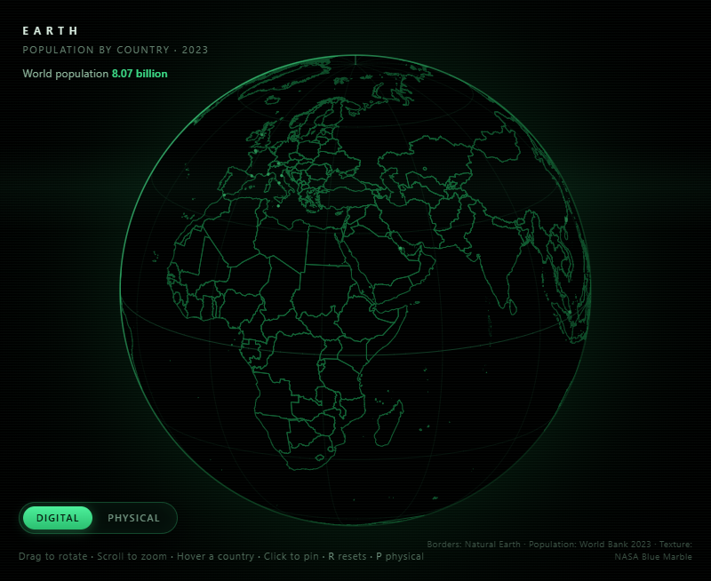

# Earth — Population Globe

A single-file, offline globe showing every country, with populations on click.
Two display styles: **Digital** (glowing wireframe Earth with lat/lon graticule,
scanlines and CRT-style vignette, plus a small amber dot marking each country's
capital city) and **Physical** (NASA topography + bathymetry
texture — elevation-coloured land, depth-colored oceans, soft day lighting and
an atmosphere rim).

## Run

Double-click `index.html`, or open it in any modern browser.